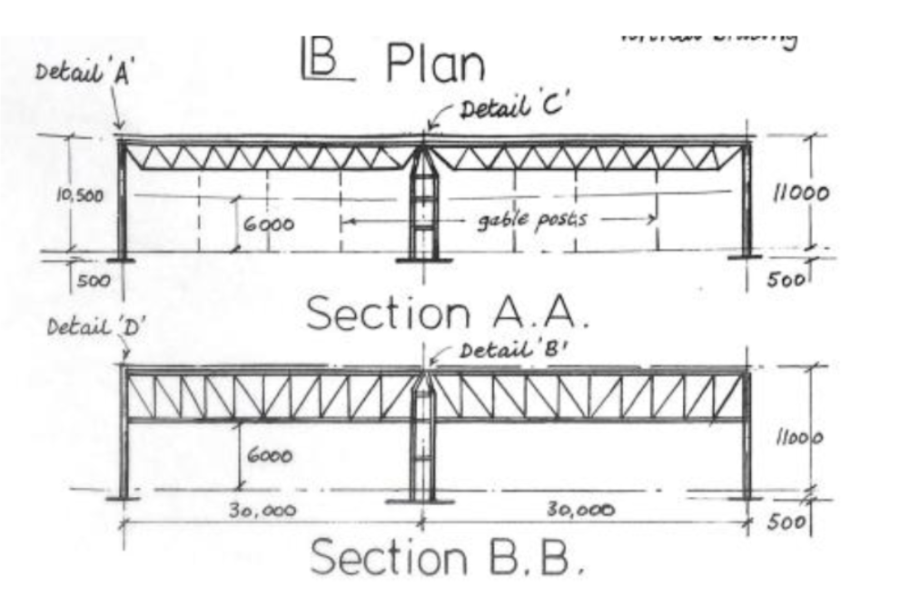
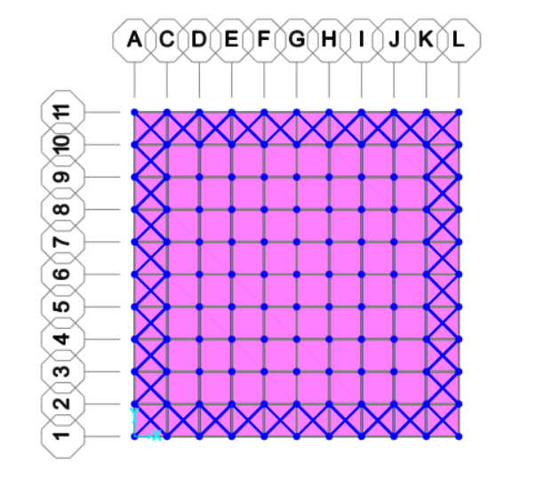
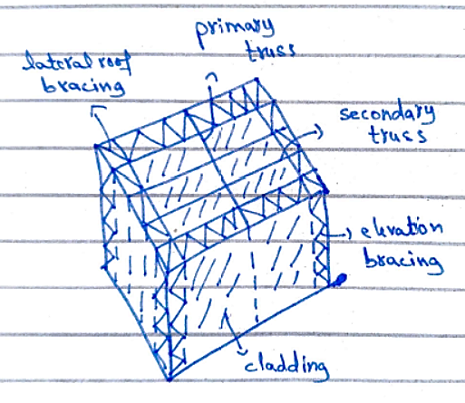
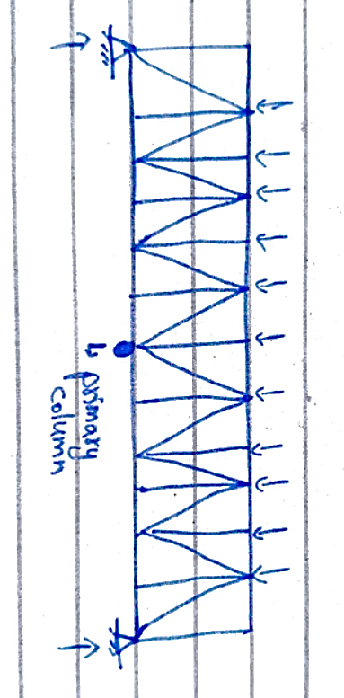
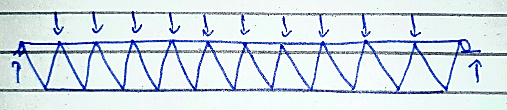
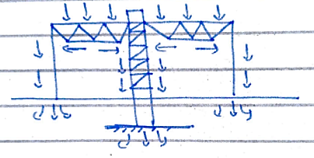
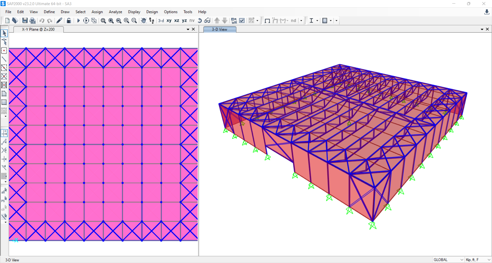
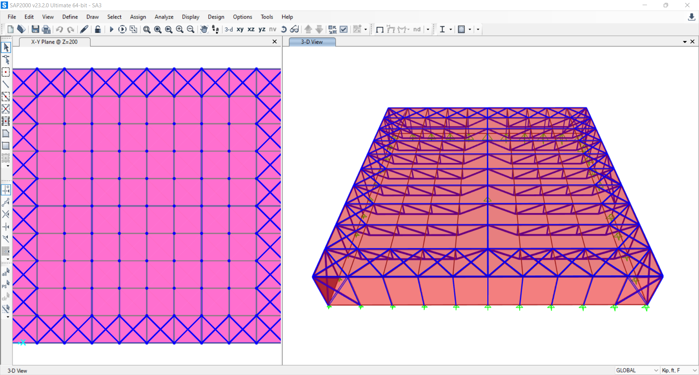

# 🏗️ Structural Steel Design & Finite Element Analysis: 200 ft × 200 ft Industrial Manufacturing Facility


[](https://www.csiamerica.com/products/sap2000)
[](https://www.csiamerica.com/products/etabs)
[](https://www.aisc.org/)
[](#)
[](#)
[](LICENSE)

---

## 📌 Executive Summary

This repository presents the comprehensive structural engineering design, finite element analysis (FEA), and connection appraisal for a **$200\text{ ft} \times 200\text{ ft}$ ($40,000\text{ sq ft}$ / $3,716\text{ m}^2$) large-span industrial manufacturing facility (Polythene Processing Plant)**.

The project was developed as a **Complex Engineering Problem (CEP)** in the 7th Semester Civil Engineering curriculum, addressing architectural span constraints, high wind pressures, and structural stability governed by **AISC 360 (LRFD)** and **ASCE 7** standards.

The complete engineering models are provided in both **CSI SAP2000** (`.sdb`, `.s2k`) and **CSI ETABS** (`.EDB`) formats, alongside full design calculations, 3D structural renders, framing schemes, and lecture technical guides.

---

## 🏢 Architectural Constraints & Client Brief

| Design Requirement | Specification | Engineering Implication |
| :--- | :--- | :--- |
| **Footprint Dimensions** | $200\text{ ft} \times 200\text{ ft}$ ($61\text{ m} \times 61\text{ m}$) | Massive single-storey enclosed footprint ($40,000\text{ sq ft}$) |
| **Interior Column Allowance** | **Strictly ONE central column** | Maximum span from center to perimeter $= 100\text{ ft}$ ($30.5\text{ m}$) |
| **Internal Clear Height** | Minimum $20\text{ ft}$ ($6.1\text{ m}$) | Clearance beneath lower truss chords for cranes and forklifts |
| **Primary Industrial Opening** | $16\text{ ft}$ high sliding cargo door | Requires specialized portal lintels and interrupted perimeter bracing |
| **Roof Cladding & Daylighting** | Profiled steel sandwich panels with 50% roof translucent daylighting | Lightweight roof requiring wind uplift suction resistance |
| **Fenestration** | Zero perimeter windows | Industrial airtightness for polythene manufacturing environment |

---

## 📐 Structural Framing Concept (Scheme 1)



To satisfy the client constraint of allowing only a single internal column, **Scheme 1** was engineered with a radial orthogonal load distribution:

### 1. Gravity Load Resisting System (GLRS)
- **Central Mega-Column**: Centrally positioned at $(X=100\text{ ft}, Y=100\text{ ft})$, supporting the four quadrants of the roof system and carrying approximately $25\%$ of the total building gravity load directly into a high-capacity foundation pad.
- **Two-Way Primary Trusses**: Heavy steel space trusses spanning $100\text{ ft}$ from the central column outward to the four perimeter midpoint columns.
- **Secondary Roof Trusses**: Orthogonally framed secondary trusses spaced at $20\text{ ft}$ on-center, delivering tributary roof loads directly to primary truss node panels.
- **Perimeter Columns**: Sized for combined axial compression and out-of-plane wind bending.



### 2. Lateral Force Resisting System (LFRS)
- **Roof Horizontal Bracing Diaphragm**: Planar truss bracing across roof panel bays transferring lateral wind shear from the wall cladding to the building edges.
- **Elevation Vertical Cross-Bracing**: X-braced and diagonal portal frames on all four exterior perimeter elevations delivering wind shear down to the base anchors.



---

## 🔍 Structural Truss Geometry & Member Profiles

The structural steel members were modeled and verified against AISC standard shapes:

### Primary Truss Cross-Section

- **Top & Bottom Chords**: Heavy wide-flange shapes (ASTM A992 Grade 50, $F_y = 50\text{ ksi}$) sized for axial tension and compression under maximum sagging and hogging moments.
- **Web Diagonals & Verticals**: Angle and double-angle profiles (ASTM A36 / A500) designed for reversible tension/compression wind cycles.

### Secondary Truss Cross-Section

- Pratt / Warren configuration with panel points aligned directly to roof purlin locations to eliminate secondary bending in chord members.

---

## ⚖️ Loading Criteria & Governing Load Combinations

All loads are calculated according to **ASCE 7 / UBC / Building Code of Pakistan**:

### 1. Nominal Load Intensities
- **Dead Load ($D$)**:
  - Profiled steel sandwich cladding: $0.30\text{ kN/m}^2$ ($6.3\text{ psf}$)
  - Structural steel framing self-weight: $0.20\text{ kN/m}^2$ ($4.2\text{ psf}$)
  - Total Dead Load ($D$) $= 10.5\text{ psf}$ ($0.50\text{ kN/m}^2$)
- **Roof Live Load ($L_r$)**:
  - Roof snow load: $0.75\text{ kN/m}^2$ ($15.7\text{ psf}$)
  - Overhead industrial MEP & lighting services: $0.65\text{ kN/m}^2$ ($13.7\text{ psf}$)
  - Total Live Load ($L$) $= 29.4\text{ psf}$ ($1.40\text{ kN/m}^2$)
- **Wind Load ($W$)**:
  - Basic wind pressure: $2.0\text{ kN/m}^2$ ($42.0\text{ psf}$)

### 2. Load Path & Governing LRFD Combinations


1. **Governing Gravity Combination**:
   $$\text{Factored Load } U = 1.2 D + 1.6 L = 1.2(10.5) + 1.6(29.4) = 59.64\text{ psf} \approx 60.0\text{ psf}$$
2. **Extreme Gravity**:
   $$U = 1.4 D = 1.4(10.5) = 14.7\text{ psf}$$
3. **Wind Uplift & Reversal (Net Tension on Chords)**:
   $$U = 0.9 D + 1.0 W = 0.9(10.5) - 42.0 = -32.55\text{ psf} \quad (\text{Net Suction Uplift})$$
4. **Serviceability (Deflection Control)**:
   $$U_{\text{service}} = 1.0 D + 1.0 L \quad \text{with span deflection limit } \Delta \le \frac{L}{240} \text{ to } \frac{L}{360}$$

---

## 💻 3D Finite Element Analysis (SAP2000 & ETABS)

The complete structural frame was modeled with full 6 degrees of freedom per node, member end releases at truss pin connections, and second-order $P-\Delta$ geometric nonlinear effects.

### SAP2000 Spatial Model


### CSI ETABS Building Model


---

## 🎯 Engineering Evaluation & Recommendations

| Structural Aspect | Engineering Finding | Design Recommendation |
| :--- | :--- | :--- |
| **Span Efficiency** | Central column cuts clear span from $200\text{ ft}$ down to $100\text{ ft}$ ($50\%$ reduction). | Reduces required primary truss depth from $>18\text{ ft}$ to $\sim 10\text{ ft}$, dramatically lowering building volume. |
| **Steel Tonnage** | Bending moment scales with $L^2$; four $100\text{ ft}$ spans reduce maximum moment by $\approx 75\%$. | Results in a significantly lighter, cost-effective structural steel framing package. |
| **Foundation Economy** | Concentrated gravity loads at the center are balanced by perimeter footing reactions. | A central reinforced concrete pad footing with soil bearing checks is sufficient. |
| **Critical Detailing** | The 4-way intersection at the central mega-column experiences high shear and axial transfer. | Requires stiffened gusset plates, high-strength A490 bolts, and complete-joint-penetration (CJP) groove welds. |

---

## 📂 Repository File Structure

```text
Structural-Steel-Design-Industrial-Factory/
│
├── README.md                                  # Structural project documentation
├── LICENSE                                    # MIT License
├── .gitignore                                 # CSI solver scratch & lockfile exclusions
│
├── models/
│   ├── sap2000/                               # CSI SAP2000 Structural Models
│   │   ├── GROUP2.s2k                         # Complete SAP2000 text definition (AISC 360)
│   │   ├── GROUP2.sdb                         # Binary database model
│   │   ├── SA3.sdb                            # Alternative framing run
│   │   └── Group 1.s2k                        # Initial sizing model
│   │
│   └── etabs/                                 # CSI ETABS Structural Models
│       ├── steel-cep-etabs-model-3.EDB        # 3D spatial model iteration 3
│       ├── steel-cep-etabs-model-4.EDB        # 3D spatial model iteration 4
│       └── steel-cep-etabs-model-5.EDB        # Final verified ETABS model
│
├── docs/                                      # Engineering reports & presentations
│   ├── Industrial-Factory-Steel-Design-Presentation.pptx
│   ├── Complex-Engineering-Problem-Polythene-Factory.pdf
│   ├── Complex-Engineering-Problem-Buildings-Specification.pdf
│   └── lecture-notes/                         # Design guidelines & code tutorials
│       ├── Lecture-Welded-Connections.pdf
│       ├── Lecture-Compression-Members.pdf
│       ├── Lecture-Design-of-Beams-Part1.pdf
│       ├── Lecture-Design-of-Beams-Part2.pdf
│       ├── 2nd-Order-P-Delta-Analysis-Example.pdf
│       └── SAP2000-Tutorial-Structural-Examples.pdf
│
└── media/                                     # High-resolution rendering & diagram assets
    ├── hero-steel-structure.jpg
    ├── sap2000-3d-model.png
    ├── etabs-structural-model.png
    ├── primary-truss-section.png
    ├── secondary-truss-section.png
    ├── framing-plan-view.png
    ├── lateral-bracing-system.png
    ├── load-path-diagram.png
    └── framing-scheme-sketches.png
```

---

## 🛠️ Software & File Viewing Instructions

- **Viewing SAP2000 Models (`.sdb`, `.s2k`)**:
  - Open in **CSI SAP2000 v20 or newer**.
  - `.s2k` files are plain text scripts and can be inspected in any text editor or imported directly via `File -> Import -> SAP2000 .s2k Text File`.
- **Viewing ETABS Models (`.EDB`)**:
  - Open in **CSI ETABS 2018 or newer**.

---

## 👤 Author & Academic Attribution

- **Student / Author:** [Muhammad Umer Basit](https://github.com/MuhammadUmerBasit)  
  *Civil Engineering Student*
- **Course:** Design of Steel Structures (CEP), Semester 7
- **Standards:** AISC 360-05/16 LRFD, ASCE 7-05/10

---

## 📄 License

This repository is licensed under the [MIT License](LICENSE).
